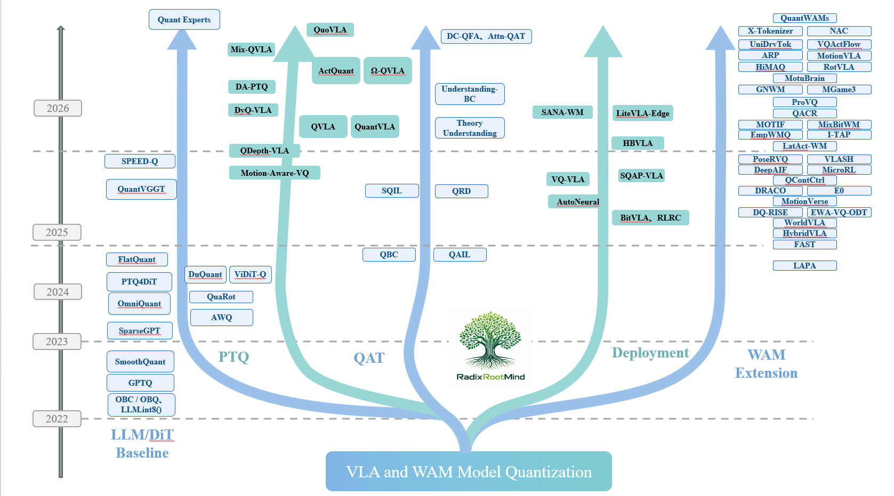
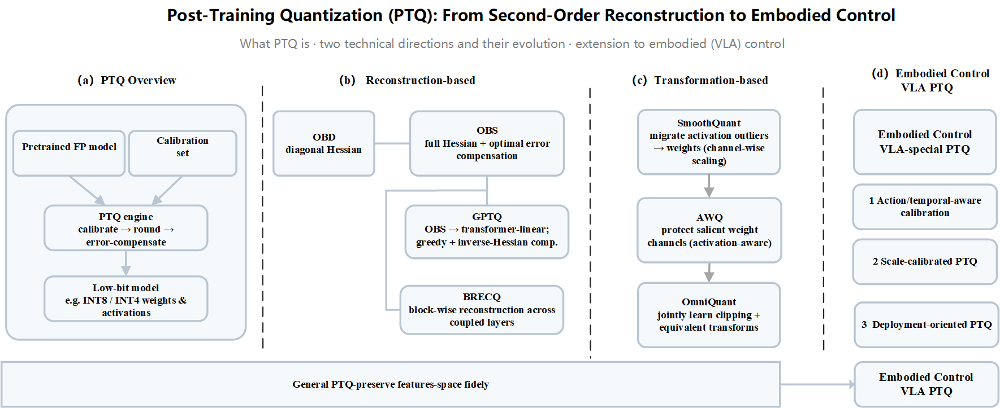
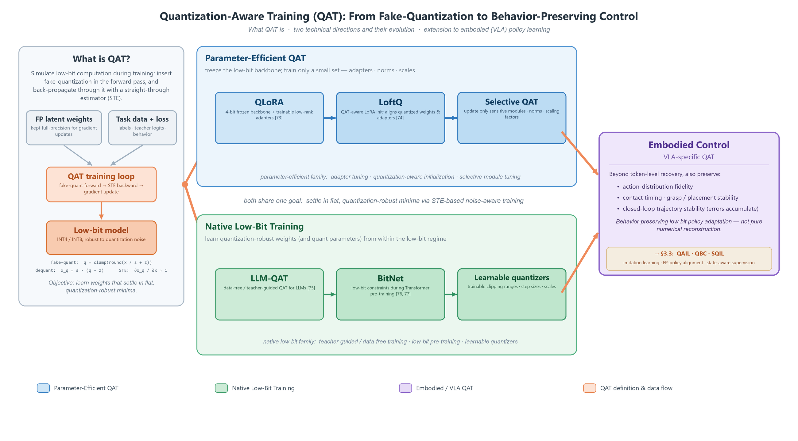

<div align="center">

# 🤖 Awesome VLA & WAM Quantization

**📜 A Curated List of Quantization Research for Vision-Language-Action (VLA) and World-Action (WAM) Models** </br>

[](https://awesome.re)


<br/>
[](https://github.com/RadixRootMind/Awesome-Quant-VLA-WAM/stargazers)
[](LICENSE)
[](https://github.com/RadixRootMind/Awesome-Quant-VLA-WAM/commits/main)

<p align="center">
  
</p>

*Compressing large embodied policies to low bit-widths — while keeping robots able to act.*

<sub>Roadmap: transferred numerical baselines (2022–24) mature into VLA-specific PTQ/QAT (2024–25), then into deployment, action, and world-action quantization (2025–26). Placement is schematic; 2026 entries are author preprints.</sub>

</div>

## News
- **2026-08** — 🔧 Companion toolkit **quant-vla** — an all-in-one VLA **PTQ + LIBERO evaluation** stack (QuantVLA · Ω-QVLA · QVLA/OpenVLA · OpenDriveLab/UniVLA-style routes) — **planned open-source release**.
- **2026-08** — Scope expanded to **World-Action Models (WAM)**: added the *Action Representation & WAM Extensions* category; the list now tracks **180+ papers**.
- **2026-08** — Added a **Results / Leaderboard** scaffold and per-category comparison tables.
- **2026-08** — Public release as *Awesome VLA & World-Action Model Quantization*.

## Overview
- 🗞️ [News](#news)
- 🎯 [Aim](#aim)
- 🔧 [Companion Toolkit: quant-vla](#companion-toolkit-quant-vla)
- 📚 [Core Concepts & Formal Definition](#core-concepts)
- ❓ [Why VLA Quantization Is Hard](#why-vla-quantization-is-hard)
- 🔍 [Survey & Taxonomy](#survey--taxonomy)

**Foundations**
- 🔁 [Transferred LLM / DiT / VLM Baselines](#transferred-llm--dit--vlm-baselines)

**VLA and WAM Quantization**
- ⚙️ [VLA-specific PTQ](#vla-specific-ptq)
- 🏋️ [Quantization-Aware Training](#quantization-aware-training)
- 🚀 [Compression & Deployment](#compression--deployment)
- 🧭 [Action Representation & WAM Extensions](#action-representation--wam-extensions)

**Context**
- 🤖 [Related VLA Models](#related-vla-models)
- 🌌 [World Models & WAM](#world-models--wam)
- 📊 [Benchmarks & Environments](#benchmarks--environments)

**Evaluation & Outlook**
- 📊 [Results / Leaderboard](#results--leaderboard)
- 📏 [How to Evaluate Quantized VLAs](#how-to-evaluate-quantized-vlas)
- 📌 [Open Challenges](#open-challenges)
- 🤝 [Contributing](#contributing)

> **Legend** — **⭐** marks landmark / foundational works · an `arXiv` badge links to the paper on arXiv · a `Scholar` badge links to a scholarly search when no canonical arXiv ID is available. Tables are grouped by the five-category taxonomy below; the **Type** column names each paper's sub-line within a category.

## Aim
This repository provides a curated and systematically organized collection of research on **quantizing VLA and WAM** — reducing the precision of weights, activations, cached states, and action representations so that large embodied policies fit the memory, latency, and energy budgets of real robots, **while preserving executable behavior** (action fidelity, trajectory stability, visual grounding, and closed-loop task success).

The repository is continuously updated as the field evolves. Contributions are highly welcome — if you know of relevant papers, methods, or benchmarks, please open a pull request or an issue. The taxonomy follows an in-progress survey, *From Foundation Models to Embodied Deployment: A Comprehensive Survey on Quantization for Vision-Language-Action and World-Action Models*.

## Companion Toolkit: quant-vla

> [!NOTE]
> **🚧 Planned open-source release.** `quant-vla` is our companion engineering stack for this list — it turns the surveyed methods into a runnable, reproducible pipeline. The repository link will go live here on release — ⭐ **star & watch** this list to be notified.

**quant-vla** is our companion engineering stack for **Vision-Language-Action (VLA) post-training quantization** and **LIBERO evaluation**, slated for open-source release. It brings **QuantVLA**, **Ω-QVLA**, **QVLA / OpenVLA**, and **OpenDriveLab / UniVLA**-style routes into one repository with shared asset conventions and reproducible validation notes.

The repository is under active development; the current focus is research reproduction, quantized evaluation, and hardware-portability preparation. Large checkpoints, quantized packs, datasets, and generated benchmark outputs are intentionally kept **outside git**.

## Core Concepts

**What makes VLA quantization its own problem.** A VLA is a policy $\pi_\theta(a \mid o, l)$ mapping an observation $o$ and instruction $l$ to an action $a$, trained by an imitation objective

$$
\mathcal{L}_{\text{VLA}} = \mathbb{E}_{(o,l,a)\sim\mathcal{D}}\big[\,\ell\big(\pi_\theta(o, l),\, a\big)\big],
$$

where $\ell$ is a cross-entropy over discretized action tokens for autoregressive VLAs (RT-2, OpenVLA) — the special case $-\log \pi_\theta(a \mid o, l)$ — or a flow-matching / diffusion denoising loss for continuous-action VLAs (π0, HybridVLA). Numerical PTQ for LLMs / DiTs picks a low-bit $\hat\theta$ by minimizing a differentiable **surrogate** — typically the layer-output error $\min_{\hat\theta}\mathbb{E}_x\lVert f_\theta(x)-f_{\hat\theta}(x)\rVert_2^2$. A robot, however, is judged by **executed behavior**. What we ultimately want is the highest closed-loop task success under a bit budget,

$$
\max_{\hat\theta}\; \mathbb{E}_{\tau\sim\pi_{\hat\theta}}\big[\mathrm{Success}(\tau)\big]\qquad\text{s.t.}\qquad \bar b(\hat\theta)\le b,
$$

but $\mathrm{Success}(\cdot)$ is non-differentiable and requires closed-loop rollouts, so methods optimize the surrogate and *hope* it transfers. Because each action changes future observations, a small per-layer error can compound across a rollout into trajectory failure — **low reconstruction error does not imply high task success.** Closing this surrogate-to-success gap is what the whole list is organized around.

The list separates five coupled concepts. Each row's exemplar is the canonical starting point for that thread.

| Concept | Compresses / adapts | Success is judged by | Exemplar |
|---|---|---|---|
| **VLA Quantization** | full-precision embodied policy → low-bit | closed-loop task success | [QVLA](https://scholar.google.com/scholar?q=Not+All+Channels+Are+Equal+in+Vision-Language-Action+Model+Quantization) |
| **PTQ** | pretrained policy, calibration set only (no gradients) | action fidelity after calibration | [QuantVLA](https://arxiv.org/abs/2602.20309) |
| **QAT** | the training / fine-tuning process | behavior after low-bit adaptation | [QAIL](https://arxiv.org/abs/2412.01034) |
| **Action-Representation Quant.** | the action interface (tokens, codecs, latents) | discretization vs. backbone error | [FAST](https://arxiv.org/abs/2501.09747) |
| **WAM Quantization** | world-action predictive dynamics | rollout & planning stability | [QuantWAMs](https://arxiv.org/abs/2607.28405) |

## Why VLA Quantization Is Hard
- 🧠 **Heterogeneous modules.** The visual encoder, LLM/VLM backbone, multimodal projector, DiT-style action head, and action decoder each have *different* low-bit sensitivity.
- ⏱️ **Temporal error propagation.** Low-bit errors accumulate across closed-loop steps, especially during grasping, contact, and placement.
- 🎯 **Action-level calibration.** Calibration data must reflect observations, instructions, robot states, and action contexts — not just text or image–text pairs.
- 🧩 **Representation coupling.** Action tokenizers and latent action spaces can amplify or absorb backbone quantization error, so representation and precision cannot be tuned in isolation.

## Survey & Taxonomy

**Techniques inherited from LLM / DiT / VLM quantization**

| Source area | Representative idea | Representative methods |
|---|---|---|
| Classical compression | Second-order reconstruction, block reconstruction, learned step size | OBD, OBS, OBC, BRECQ, LSQ |
| LLM PTQ | Weight-only / activation-aware quantization, outlier smoothing | GPTQ, AWQ, SmoothQuant, OmniQuant |
| Rotation / calibration | Outlier redistribution, equivalent transforms, flatness-aware calibration | QuaRot, DuQuant, FlatQuant |
| QAT / low-bit training | Fake quantization, adapter recovery, low-bit Transformer training | QLoRA, LoftQ, LLM-QAT, BitNet |
| DiT / diffusion | Timestep-aware calibration, diffusion activation quantization | PTQ4DiT, ViDiT-Q |

**Five-category taxonomy of VLA quantization**

| # | Category | Compresses / adapts | Representative methods |
|---|---|---|---|
| 1 | Transferred LLM / DiT / VLM baselines | Foundation-model backbone | GPTQ, AWQ, SmoothQuant, QuaRot, PTQ4DiT, SPEED-Q, QuantVGGT |
| 2 | VLA-specific PTQ | Pretrained VLA policy | QVLA, ActQuant, Mix-QVLA, DA-PTQ, DyQ-VLA, QuantVLA, Ω-QVLA, QuoVLA |
| 3 | Quantization-aware training | Training / fine-tuning process | QAIL, QBC, SQIL, QRD, Attn-QAT, DPVO-QAT++ |
| 4 | Compression & deployment | System-level robotic execution | BitVLA, HBVLA, SQAP-VLA, RLRC, LiteVLA-Edge, EdgeNav-QE |
| 5 | Action-representation & WAM extensions | Action / world representation interface | FAST, VQ-VLA, X-Tokenizer, NAC, RotVLA, QuantWAMs, ResTacVLA |

> [!IMPORTANT]
> **The through-line.** Categories 1→5 trace a single arc: **numerical methods borrowed from LLM/DiT/VLM (1)** are re-targeted from layer-output preservation to **action-space preservation (2–3)**, made deployable under real robot constraints **(4)**, and finally pushed into the **action and world-action representations themselves (5)**, where discretization and model precision become inseparable.

**Related surveys**
- Vision-Language-Action (VLA) Models: Concepts, Progress, Applications and Challenges. [](https://arxiv.org/abs/2505.04769)
- A Survey on Vision-Language-Action Models for Embodied AI. [](https://arxiv.org/abs/2405.14093)
- World Action Models: A Survey. [](https://arxiv.org/abs/2606.20781)
- World Model for Robot Learning: A Comprehensive Survey. [](https://arxiv.org/abs/2605.00080)

---

## Transferred LLM / DiT / VLM Baselines
*Not designed for embodied control, but they provide the numerical starting point — and reveal where "preserve layer outputs" fails under action generation.*

<p align="center">
  
</p>
<sub>**Figure 1.** The PTQ lineage this survey builds on — second-order reconstruction (OBD→OBS→GPTQ/BRECQ) and transformation/rotation (SmoothQuant→AWQ→OmniQuant) methods, re-targeted toward embodied control.</sub>

| Method | Type | Title | Paper |
|---|---|---|---|
| ⭐ **OBD** | Classical | Optimal Brain Damage | [](https://scholar.google.com/scholar?q=Optimal+Brain+Damage+LeCun) |
| ⭐ **OBS** | Classical | Second Order Derivatives for Network Pruning: Optimal Brain Surgeon | [](https://scholar.google.com/scholar?q=Second+Order+Derivatives+for+Network+Pruning+Optimal+Brain+Surgeon) |
| **OBC** | Classical | Optimal Brain Compression: Accurate Post-Training Quantization and Pruning | [](https://arxiv.org/abs/2208.11580) |
| **BRECQ** | Classical | Pushing the Limit of PTQ by Block Reconstruction | [](https://arxiv.org/abs/2102.05426) |
| **LSQ** | Classical | Learned Step Size Quantization | [](https://arxiv.org/abs/1902.08153) |
| **Wanda** | Classical | A Simple and Effective Pruning Approach for Large Language Models | [](https://arxiv.org/abs/2306.11695) |
| **Integer-Only Inference** | Classical | Quantization and Training of Neural Networks for Efficient Integer-Arithmetic-Only Inference | [](https://arxiv.org/abs/1712.05877) |
| ⭐ **GPTQ** | LLM PTQ | Accurate Post-Training Quantization for Generative Pre-trained Transformers | [](https://arxiv.org/abs/2210.17323) |
| ⭐ **AWQ** | LLM PTQ | Activation-aware Weight Quantization for LLM Compression and Acceleration | [](https://arxiv.org/abs/2306.00978) |
| ⭐ **SmoothQuant** | LLM PTQ | Accurate and Efficient Post-Training Quantization for Large Language Models | [](https://arxiv.org/abs/2211.10438) |
| **LLM.int8()** | LLM PTQ | 8-bit Matrix Multiplication for Transformers at Scale | [](https://arxiv.org/abs/2208.07339) |
| **OmniQuant** | LLM PTQ | Omnidirectionally Calibrated Quantization for Large Language Models | [](https://arxiv.org/abs/2308.13137) |
| **QuaRot** | LLM PTQ | Outlier-Free 4-Bit Inference in Rotated LLMs | [](https://arxiv.org/abs/2404.00456) |
| **DuQuant** | LLM PTQ | Distributing Outliers via Dual Transformation | [](https://arxiv.org/abs/2406.01721) |
| **FlatQuant** | LLM PTQ | Flatness Matters for LLM Quantization | [](https://arxiv.org/abs/2410.09426) |
| **STE** | QAT base | Estimating or Propagating Gradients Through Stochastic Neurons for Conditional Computation | [](https://arxiv.org/abs/1308.3432) |
| **Understanding STE** | QAT base | Understanding Straight-Through Estimator in Training Activation Quantized Neural Nets | [](https://scholar.google.com/scholar?q=Understanding+Straight-Through+Estimator+in+Training+Activation+Quantized+Neural+Nets) |
| **QLoRA** | QAT base | Efficient Finetuning of Quantized LLMs | [](https://arxiv.org/abs/2305.14314) |
| **LoftQ** | QAT base | LoRA-Fine-Tuning-Aware Quantization for Large Language Models | [](https://arxiv.org/abs/2310.08659) |
| **LLM-QAT** | QAT base | Data-Free Quantization-Aware Training for Large Language Models | [](https://arxiv.org/abs/2305.17888) |
| **BitNet** | QAT base | Scaling 1-bit Transformers for Large Language Models | [](https://arxiv.org/abs/2310.11453) |
| **BitNet b1.58** | QAT base | The Era of 1-bit LLMs: All LLMs are in 1.58 Bits | [](https://arxiv.org/abs/2402.17764) |
| ⭐ **PTQ4DiT** | DiT | Post-training Quantization for Diffusion Transformers | [](https://arxiv.org/abs/2405.16005) |
| **ViDiT-Q** | DiT | Efficient and Accurate Quantization of Diffusion Transformers | [](https://arxiv.org/abs/2406.02540) |
| **SPEED-Q** | VLM PTQ | Staged Processing with Enhanced Distillation for Efficient Low-bit On-device VLM Quantization | [](https://arxiv.org/abs/2511.08914) |
| **Quant Experts** | VLM PTQ | Token-aware Adaptive Error Reconstruction with MoE for Large VLM Quantization | [](https://arxiv.org/abs/2602.24059) |
| **QuantVGGT** | VLM PTQ | Quantized Visual Geometry Grounded Transformer | [](https://arxiv.org/abs/2509.21302) |
| **SplitQ** | VLM PTQ | Breaking Modality Heterogeneity in Low-Bit Quantization for Large VLMs | [](https://arxiv.org/abs/2605.19929) |
| **Best Practices for VLM Quant.** | VLM PTQ | Towards Understanding Best Practices for Quantization of Vision-Language Models | [](https://arxiv.org/abs/2601.15287) |
| **OSAQ** | VLM PTQ | Outlier Self-Absorption for Accurate Low-bit LLM Quantization | [](https://arxiv.org/abs/2605.04738) |

<sub>VLAs inherit VLM backbones, so the *VLM PTQ* rows bound what VLA PTQ can achieve.</sub>

## VLA-specific PTQ
*Extends feature-space reconstruction to **action-space preservation**, organized by the error source each method targets.*

| Method | Type | Title | Paper |
|---|---|---|---|
| ⭐ **QVLA** | Sensitivity-aware | Not All Channels Are Equal in Vision-Language-Action Model Quantization | [](https://scholar.google.com/scholar?q=Not+All+Channels+Are+Equal+in+Vision-Language-Action+Model+Quantization) |
| **ActQuant** | Sensitivity-aware | Sub-4-bit Action-Guided Quantization for Vision-Language-Action Models | [](https://arxiv.org/abs/2605.24011) |
| **Mix-QVLA** | Sensitivity-aware | Task-Evidence-Aware Mixed-Precision Quantization of VLA Models | [](https://arxiv.org/abs/2606.19565) |
| **DA-PTQ** | Temporal-adaptive | Drift-Aware Post-Training Quantization for Efficient VLA Models | [](https://arxiv.org/abs/2604.11572) |
| **DyQ-VLA** | Temporal-adaptive | Temporal-Dynamic-Aware Quantization for Embodied VLA Models | [](https://arxiv.org/abs/2603.07904) |
| ⭐ **QuantVLA** | Scale-calibrated | Scale-Calibrated Post-Training Quantization for Vision-Language-Action Models | [](https://arxiv.org/abs/2602.20309) |
| ⭐ **Ω-QVLA** | Scale-calibrated | Robust Quantization for VLA Models via Composite Rotation and Per-step Scaling | [](https://arxiv.org/abs/2605.28803) |
| **QuoVLA** | Latent-representation | Quotient Space for Vision-Language-Action Models | [](https://arxiv.org/abs/2605.24890) |
| **Motion-Aware VQ** | Latent-representation | A Motion-Aware Vector Quantization Framework with Centroid Reuse for Efficient VLA Inference | [](https://arxiv.org/abs/2607.24148) |
| **QDepth-VLA** | Latent-representation | Quantized Depth Prediction as Auxiliary Supervision for VLA Models | [](https://arxiv.org/abs/2510.14836) |
| **Rethinking VLM Calibration** | Backbone bound | Rethinking Practical and Efficient Quantization Calibration for Vision-Language Models | [](https://arxiv.org/abs/2602.07899) |
| **Bi-VLM** | Backbone bound | Pushing Ultra-Low Precision Post-Training Quantization Boundaries in Vision-Language Models | [](https://arxiv.org/abs/2509.18763) |
| **LUQ** | Backbone bound | Layerwise Ultra-Low Bit Quantization for Multimodal LLMs | [](https://arxiv.org/abs/2509.23729) |
| **VEQ** | Backbone bound | Modality-Adaptive Quantization for MoE Vision-Language Models | [](https://arxiv.org/abs/2602.01037) |
| **VQA Reliability under PTQ** | Backbone bound | Evaluating the Impact of Post-Training Quantization on Reliable VQA with Multimodal LLMs | [](https://arxiv.org/abs/2602.13289) |

## Quantization-Aware Training
*Behavior-preserving low-bit **policy adaptation** — not generic fake-quantization training.*

<p align="center">
  
</p>
<sub>**Figure 2.** The QAT lineage — fake-quantization & STE, parameter-efficient QAT (QLoRA→LoftQ→Selective QAT) and native low-bit training (LLM-QAT→BitNet), re-targeted toward behavior-preserving robotic control.</sub>

| Method | Type | Title | Paper |
|---|---|---|---|
| ⭐ **QAIL** | Imitation-based | Quantization-Aware Imitation-Learning for Resource-Efficient Robotic Control | [](https://arxiv.org/abs/2412.01034) |
| **QBC** | Distillation-guided | Quantization-Robust Behavior Cloning: aligning low-bit policies with full-precision action distributions | [](https://arxiv.org/abs/2412.01034) |
| **QRD** | Distillation-guided | Quantization-Robust Action Distillation for mission-critical state supervision | [](https://arxiv.org/abs/2505.15304) |
| ⭐ **SQIL** | Saliency-aware | Saliency-Aware Quantized Imitation Learning for Efficient Robotic Control | [](https://arxiv.org/abs/2505.15304) |
| **Understanding BC w/ Action Quant.** | BC theory | Understanding Behavior Cloning with Action Quantization | [](https://arxiv.org/abs/2603.20538) |
| **DC-QFA** | Hardware/attention | Device-Conditioned Neural Architecture Search for Efficient Robotic Manipulation | [](https://arxiv.org/abs/2604.10170) |
| **Attn-QAT** | Hardware/attention | 4-Bit Attention With Quantization-Aware Training | [](https://arxiv.org/abs/2603.00040) |
| **GRACE** | Reusable backbone | Gated Relational Alignment via Confidence-based Distillation for Efficient VLMs | [](https://arxiv.org/abs/2601.22709) |
| **TernaryCLIP** | Reusable backbone | Compressing Vision-Language Models with Ternary Weights and Distilled Knowledge | [](https://arxiv.org/abs/2510.21879) |
| **FTerViT** | Reusable backbone | Fully Ternary Vision Transformer | [](https://arxiv.org/abs/2605.21171) |
| **DPVO-QAT++** | Reusable backbone | Heterogeneous QAT and CUDA Kernel Fusion for High-Performance Deep Patch Visual Odometry | [](https://arxiv.org/abs/2511.12653) |

## Compression & Deployment
*Can the compressed policy actually be deployed under real robotic constraints? Lower bit-width ≠ lower latency.*

| Method | Type | Title | Paper |
|---|---|---|---|
| ⭐ **BitVLA** | Binary / ternary | 1-bit Vision-Language-Action Models for Robotics Manipulation | [](https://scholar.google.com/scholar?q=BitVLA+1-bit+Vision-Language-Action+Models+for+Robotics+Manipulation) |
| **HBVLA** | Binary / ternary | Pushing 1-Bit Post-Training Quantization for VLA Models | [](https://arxiv.org/abs/2602.13710) |
| **SQAP-VLA** | Quant–prune co-design | A Synergistic Quantization-Aware Pruning Framework for High-Performance VLA Models | [](https://arxiv.org/abs/2509.09090) |
| **RLRC** | Recovery / edge | Reinforcement Learning-based Recovery for Compressed VLA Models | [](https://arxiv.org/abs/2506.17639) |
| **LiteVLA-Edge** | Recovery / edge | Quantized On-Device Multimodal Control for Embedded Robotics | [](https://arxiv.org/abs/2603.03380) |
| **SANA-WM** | Recovery / edge | Efficient Minute-Scale World Modeling with Hybrid Linear Diffusion Transformer (NVFP4 deployment) | [](https://arxiv.org/abs/2605.15178) |
| **AutoNeural** | Recovery / edge | Co-Designing Vision-Language Models for NPU Inference | [](https://arxiv.org/abs/2512.02924) |
| **WindowQuant** | KV-cache co-design | Mixed-Precision KV Cache Quantization based on Window-Level Similarity for VLMs | [](https://arxiv.org/abs/2605.02262) |
| **Joint Quant + Token Pruning** | KV-cache co-design | Towards Joint Quantization and Token Pruning of Vision-Language Models | [](https://arxiv.org/abs/2604.17320) |
| **QAPruner** | KV-cache co-design | Quantization-Aware Vision Token Pruning for Multimodal LLMs | [](https://arxiv.org/abs/2604.02816) |
| **RateQuant** | KV-cache co-design | Optimal Mixed-Precision KV Cache Quantization via Rate-Distortion Theory | [](https://arxiv.org/abs/2605.06675) |
| **PolyKV** | KV-cache co-design | A Shared Asymmetrically-Compressed KV Cache Pool for Multi-Agent LLM Inference | [](https://arxiv.org/abs/2604.24971) |
| **LQA** | On-device system | A Lightweight Quantized-Adaptive Framework for Vision-Language Models on the Edge | [](https://arxiv.org/abs/2602.07849) |
| **CommandSwarm** | On-device system | Safety-Aware Natural Language-to-Behavior-Tree Generation for Robotic Swarms (4-bit + LoRA) | [](https://arxiv.org/abs/2605.07764) |
| **BitTP** | On-device system | The Lightweight Trajectory Prediction Model with BitLLM for Edge Devices | [](https://arxiv.org/abs/2605.29705) |
| **WSVD** | On-device system | Weighted Low-Rank Approximation for Fast Low-Precision VLM Execution | [](https://arxiv.org/abs/2604.02570) |
| **EdgeNav-QE** | On-device system | QLoRA Quantization and Dynamic Early Exit for LAM-based Navigation on Edge Devices | [](https://arxiv.org/abs/2602.15836) |
| **Collaborative Inference** | On-device system | Quantization-Aware Collaborative Inference for Large Embodied AI Models | [](https://arxiv.org/abs/2602.13052) |

## Action Representation & WAM Extensions
*Quantize the **action interface** itself — action tokens, neural codecs, latent/rotational actions, world-action representations — where coarse discretization amplifies model error.*

**Action tokenization / vector-quantized action tokenizers**

| Method | Title | Paper |
|---|---|---|
| ⭐ **FAST** | Efficient Action Tokenization for Vision-Language-Action Models | [](https://arxiv.org/abs/2501.09747) |
| ⭐ **VQ-VLA** | Improving VLA Models via Scaling Vector-Quantized Action Tokenizers | [](https://scholar.google.com/scholar?q=VQ-VLA+Improving+Vision-Language-Action+Models+Scaling+Vector-Quantized+Action+Tokenizers) |
| ⭐ **LAPA** | Latent Action Pretraining from Videos | [](https://arxiv.org/abs/2410.11758) |
| **X-Tokenizer** | A Multimodal Action Tokenizer for Vision-Language-Action Pretraining | [](https://arxiv.org/abs/2606.14752) |
| **NAC** | Neural Action Codec for Vision-Language-Action Models | [](https://arxiv.org/abs/2606.21372) |
| **RotVLA** | Rotational Latent Action for Vision-Language-Action Model | [](https://arxiv.org/abs/2605.13403) |
| **VQActFlow** | Vector-Quantized Action Mode Steering for Multi-Task Robot Manipulation | [](https://arxiv.org/abs/2606.21600) |
| **ARP** | Enhancing Quantized Skill Abstractions via Visual Alignment and Iterative Refinement | [](https://arxiv.org/abs/2606.22480) |
| **HiMAQ** | Enhancing Human-Likeness in RL Agents via Hierarchical Macro Action Quantization | [](https://arxiv.org/abs/2605.30928) |
| **E0** | Enhancing Generalization and Fine-Grained Control in VLA via Tweedie Discrete Diffusion | [](https://arxiv.org/abs/2511.21542) |
| **VLASH** | Real-Time VLAs via Future-State-Aware Asynchronous Inference | [](https://arxiv.org/abs/2512.01031) |
| **DQ-RISE** | Learning Dexterous Manipulation with Quantized Hand State | [](https://arxiv.org/abs/2509.17450) |
| **EWA-VQ-ODT** | Mental Accounts for Actions: EWA-Inspired Attention in Decision Transformers | [](https://arxiv.org/abs/2509.15498) |
| **Deep Active Inference** | Real-World Robot Control by Deep Active Inference with a Temporally Hierarchical World Model | [](https://arxiv.org/abs/2512.01924) |
| **OAT** | Ordered Action Tokens for Visuomotor Policy Learning | [](https://arxiv.org/abs/2607.21670) |
| **MAQ** | Learning Human-Like RL Agents Through Trajectory Optimization With Action Quantization | [](https://arxiv.org/abs/2511.15055) |
| **MotionVLA** | Vision-Language-Action Model for Humanoid Motion | [](https://arxiv.org/abs/2606.15142) |
| **MOTIF** | Learning Action Motifs for Few-shot Cross-Embodiment Transfer | [](https://arxiv.org/abs/2602.13764) |
| **I-TAP** | In-Context Planning with Latent Temporal Abstractions | [](https://arxiv.org/abs/2602.18694) |
| **MotionVerse** | A Unified Multimodal Framework for Motion Comprehension, Generation and Editing | [](https://arxiv.org/abs/2509.23635) |
| **Pose-Guided RVQ** | Pose-Guided Residual Refinement for Interpretable Text-to-Motion Generation | [](https://arxiv.org/abs/2512.22464) |
| **ProVQ** | Mitigating Premature Discretization with Progressive Quantization for Robust Vector Tokenization | [](https://arxiv.org/abs/2603.22304) |

**World-model / WAM quantization**

| Method | Title | Paper |
|---|---|---|
| **QuantWAMs** | Calibrating at the Right Granularity for World Action Models | [](https://arxiv.org/abs/2607.28405) |
| **Empirical WM-Quant** | An Empirical Study of World Model Quantization | [](https://arxiv.org/abs/2602.02110) |
| **Mixed-Bit WM Planning** | Where Bits Matter in World Model Planning: A Paired Mixed-Bit Study | [](https://arxiv.org/abs/2602.11882) |
| **GNWM** | The Global Neural World Model: Spatially Grounded Discrete Topologies for Action-Conditioned Planning | [](https://arxiv.org/abs/2604.16585) |
| **Unified Driving Tokens** | Representation- and Geometry-Guided Discrete Tokenizer for Driving World Models | [](https://arxiv.org/abs/2606.01935) |
| **Latent-Action WM** | Learning Latent Action World Models In The Wild | [](https://arxiv.org/abs/2601.05230) |
| **GCQ** | Vector Quantization in the Brain: Grid-like Codes in World Models | [](https://arxiv.org/abs/2510.16039) |
| **Matrix-Game 3.0** | Real-Time and Streaming Interactive World Model with Long-Horizon Memory | [](https://arxiv.org/abs/2604.08995) |

**Hardware- & control-oriented quantization**

| Method | Title | Paper |
|---|---|---|
| **DRACO** | Co-design for DSP-Efficient Rigid Body Dynamics Accelerator | [](https://arxiv.org/abs/2511.08395) |
| **Quantized Continuous Controllers** | Learning Quantized Continuous Controllers for Integer Hardware | [](https://arxiv.org/abs/2511.07046) |
| **QACR** | Towards Long-Lived Robots: Continual Learning VLA Models via RL Fine-Tuning | [](https://arxiv.org/abs/2602.10503) |
| **Microrobot RL Control** | Control of Microrobots with RL under On-Device Compute Constraints | [](https://arxiv.org/abs/2512.24740) |

**Perception & multimodal representation quantization**

| Method | Title | Paper |
|---|---|---|
| **ReVQom** | Residual Vector Quantization for Communication-Efficient Multi-Agent Perception | [](https://arxiv.org/abs/2509.21464) |
| **Point-Cloud Quant** | Point Cloud Quantization through Multimodal Prompting for 3D Understanding | [](https://arxiv.org/abs/2511.12079) |
| **ResTacVLA** | Feeling the Unexpected: Contact-Rich Manipulation via Residual Tactile Representation | [](https://arxiv.org/abs/2607.03387) |

---

## Related VLA Models
*Three architectural families; each exposes different quantization-sensitive modules.*

- **Monolithic** — unified backbone emits actions; sensitive to shared-backbone, action-token, and decoder quantization.
- **Cascaded** — VLM/LLM planner + action expert; sensitive to scale mismatch at the planner↔controller interface.
- **Hierarchical** — explicit intermediate plans / skills / latent actions; sensitive to the precision of those representations.

| Method | Family | Title | Paper |
|---|---|---|---|
| ⭐ **RT-2** | Monolithic | Vision-Language-Action Models Transfer Web Knowledge to Robotic Control | [](https://arxiv.org/abs/2307.15818) |
| **RT-1** | Monolithic | Robotics Transformer for Real-World Control at Scale | [](https://arxiv.org/abs/2212.06817) |
| **Gato** | Monolithic | A Generalist Agent | [](https://arxiv.org/abs/2205.06175) |
| ⭐ **OpenVLA** | Monolithic | An Open-Source Vision-Language-Action Model | [](https://arxiv.org/abs/2406.09246) |
| **OpenVLA-OFT** | Monolithic | Optimizing OpenVLA for Fine-Tuned Robotic Control | [](https://scholar.google.com/scholar?q=OpenVLA-OFT+Optimizing+OpenVLA+Fine-Tuned+Robotic+Control) |
| **Octo** | Monolithic | An Open-Source Generalist Robot Policy | [](https://arxiv.org/abs/2405.12213) |
| ⭐ **π0** | Monolithic | A Vision-Language-Action Flow Model for General Robot Control | [](https://arxiv.org/abs/2410.24164) |
| **π0.5** | Monolithic | A Vision-Language-Action Model with Open-World Generalization | [](https://arxiv.org/abs/2504.16054) |
| **π0.7** | Monolithic | A Steerable Generalist Robotic Foundation Model with Emergent Capabilities | [](https://arxiv.org/abs/2604.15483) |
| **RoboFlamingo** | Monolithic | Vision-Language Foundation Models as Effective Robot Imitators | [](https://arxiv.org/abs/2311.01378) |
| **OpenFlamingo** | Monolithic | An Open-Source Framework for Training Large Autoregressive Vision-Language Models | [](https://arxiv.org/abs/2308.01390) |
| **CoT-VLA** | Monolithic | Visual Chain-of-Thought Reasoning for Vision-Language-Action Models | [](https://scholar.google.com/scholar?q=CoT-VLA+Visual+Chain-of-Thought+Reasoning+Vision-Language-Action+Models) |
| **UP-VLA** | Monolithic | A Unified Understanding and Prediction Model for Embodied Agent | [](https://arxiv.org/abs/2501.18867) |
| **NORA** | Monolithic | A Small Open-Sourced Generalist Vision-Language-Action Model for Embodied Tasks | [](https://arxiv.org/abs/2504.19854) |
| **TraceVLA** | Monolithic | Visual Trace Prompting Enhances Spatial-Temporal Awareness for Generalist Robotic Policies | [](https://arxiv.org/abs/2412.10345) |
| **Diffusion-VLA** | Monolithic | Generalizable and Interpretable Robot Foundation Model via Self-Generated Reasoning | [](https://arxiv.org/abs/2412.03293) |
| **CAST** | Monolithic | Counterfactual Labels Improve Instruction Following in VLA Models | [](https://arxiv.org/abs/2508.13446) |
| **HybridVLA** | Monolithic | Collaborative Diffusion and Autoregression in a Unified VLA Model | [](https://arxiv.org/abs/2503.10631) |
| **WorldVLA** | Monolithic | Towards Autoregressive Action World Model | [](https://arxiv.org/abs/2506.21539) |
| **PD-VLA** | Monolithic | Accelerating VLA Models with Action Chunking via Parallel Decoding | [](https://arxiv.org/abs/2503.02310) |
| **Spec-VLA** | Monolithic | Speculative Decoding for VLA Models with Relaxed Acceptance | [](https://scholar.google.com/scholar?q=Spec-VLA+Speculative+Decoding+Vision-Language-Action+Models+Relaxed+Acceptance) |
| ⭐ **GR00T N1** | Cascaded | An Open Foundation Model for Generalist Humanoid Robots | [](https://arxiv.org/abs/2503.14734) |
| ⭐ **TinyVLA** | Cascaded | Toward Fast, Data-Efficient VLA Models for Robotic Manipulation | [](https://arxiv.org/abs/2409.12514) |
| **CogACT** | Cascaded | Synergizing Cognition and Action in Robotic Manipulation | [](https://arxiv.org/abs/2411.19650) |
| **DreamVLA** | Cascaded | A VLA Model Dreamed with Comprehensive World Knowledge | [](https://arxiv.org/abs/2507.04447) |
| **LCB** | Cascaded | From LLMs to Actions: Latent Codes as Bridges in Hierarchical Robot Control | [](https://scholar.google.com/scholar?q=Latent+Codes+as+Bridges+Hierarchical+Robot+Control) |
| **RoboDual** | Cascaded | Towards Synergistic, Generalized, and Efficient Dual-System for Robotic Manipulation | [](https://arxiv.org/abs/2410.08001) |
| **DP-VLA** | Cascaded | A Dual Process VLA: Efficient Robotic Manipulation Leveraging VLM | [](https://arxiv.org/abs/2410.15549) |
| **ConRFT** | Cascaded | A Reinforced Fine-Tuning Method for VLA Models via Consistency Policy | [](https://arxiv.org/abs/2502.05450) |
| **OpenHelix** | Cascaded | A Short Survey, Empirical Analysis, and Open-Source Dual-System VLA Model | [](https://arxiv.org/abs/2505.03912) |
| **TriVLA** | Cascaded | A Triple-System-Based Unified VLA Model with Episodic World Modeling | [](https://arxiv.org/abs/2507.01424) |
| ⭐ **SayCan** | Hierarchical | Do As I Can, Not As I Say: Grounding Language in Robotic Affordances | [](https://arxiv.org/abs/2204.01691) |
| ⭐ **PaLM-E** | Hierarchical | An Embodied Multimodal Language Model | [](https://arxiv.org/abs/2303.03828) |
| **HiRobot** | Hierarchical | Open-Ended Instruction Following with Hierarchical VLA Models | [](https://arxiv.org/abs/2502.19417) |
| **VoxPoser** | Hierarchical | Composable 3D Value Maps for Robotic Manipulation with Language Models | [](https://arxiv.org/abs/2307.05973) |
| **Instruct2Act** | Hierarchical | Mapping Multi-Modality Instructions to Robotic Actions with LLM | [](https://arxiv.org/abs/2305.11176) |
| **VILA** | Hierarchical | On Pre-training for Visual Language Models | [](https://scholar.google.com/scholar?q=VILA+On+Pre-training+for+Visual+Language+Models) |
| **SkillDiffuser** | Hierarchical | Interpretable Hierarchical Planning via Skill Abstractions in Diffusion-Based Task Execution | [](https://scholar.google.com/scholar?q=SkillDiffuser+Interpretable+Hierarchical+Planning+Skill+Abstractions) |
| **UniAct** | Hierarchical | Universal Actions for Enhanced Embodied Foundation Models | [](https://scholar.google.com/scholar?q=Universal+Actions+for+Enhanced+Embodied+Foundation+Models) |
| **Chain-of-Modality** | Hierarchical | Learning Manipulation Programs from Multimodal Human Videos with VLMs | [](https://arxiv.org/abs/2504.13351) |
| **RationalVLA** | Hierarchical | A Rational Vision-Language-Action Model with Dual System | [](https://arxiv.org/abs/2506.10826) |
| **VLA-Touch** | Hierarchical | Enhancing VLA Models with Dual-Level Tactile Feedback | [](https://arxiv.org/abs/2507.17294) |

## World Models & WAM
*Predictive-policy and world-model works that ground action-representation and WAM-oriented quantization.*

| Method | Title | Paper |
|---|---|---|
| ⭐ **World Models** | World Models | [](https://arxiv.org/abs/1803.10122) |
| **World Action Models** | The Next Frontier in Embodied AI | [](https://arxiv.org/abs/2605.12090) |
| **MotuBrain** | An Advanced World Action Model for Robot Control | [](https://arxiv.org/abs/2604.27792) |
| **Video Prediction Policy** | A Generalist Robot Policy with Predictive Visual Representations | [](https://arxiv.org/abs/2412.14803) |
| **Prediction with Action** | Visual Policy Learning via Joint Denoising Process | [](https://arxiv.org/abs/2411.18179) |
| **ARDuP** | Active Region Video Diffusion for Universal Policies | [](https://scholar.google.com/scholar?q=ARDuP+Active+Region+Video+Diffusion+for+Universal+Policies) |
| **WorldSimBench** | Towards Video Generation Models as World Simulators | [](https://arxiv.org/abs/2410.18072) |
| **VLA-JEPA** | Enhancing VLA Model with Latent World Model | [](https://arxiv.org/abs/2602.10098) |
| **BagelVLA** | Enhancing Long-Horizon Manipulation via Interleaved VLA Generation | [](https://arxiv.org/abs/2602.09849) |
| **ALAM** | Algebraically Consistent Latent Action Model for VLA Models | [](https://arxiv.org/abs/2605.10819) |
| **Mixture of Latent Actions** | From Imagined Futures to Executable Actions for Robot Manipulation | [](https://arxiv.org/abs/2605.12167) |
| **Cosmos Policy** | Fine-tuning Video Models for Visuomotor Control and Planning | [](https://arxiv.org/abs/2601.16163) |
| **LDA-1B** | Scaling Latent Dynamics Action Model via Universal Embodied Data Ingestion | [](https://arxiv.org/abs/2602.12215) |

## Benchmarks & Environments
*Common resources to train, evaluate, and stress-test VLA policies and quantized embodied systems.*

| Resource | Title | Paper |
|---|---|---|
| ⭐ **Open X-Embodiment** | Robotic Learning Datasets and RT-X Models | [](https://arxiv.org/abs/2310.08864) |
| ⭐ **LIBERO** | Benchmarking Knowledge Transfer for Lifelong Robot Learning | [](https://arxiv.org/abs/2306.03310) |
| **LIBERO-X** | Robustness Litmus for Vision-Language-Action Models | [](https://arxiv.org/abs/2602.06556) |
| **RoboTwin** | Dual-Arm Robot Benchmark with Generative Digital Twins | [](https://arxiv.org/abs/2504.13059) |
| **RoboCasa** | Large-Scale Simulation of Everyday Tasks for Generalist Robots | [](https://arxiv.org/abs/2406.02523) |
| **ManiSkill3** | GPU Parallelized Robotics Simulation and Rendering for Generalizable Embodied AI | [](https://arxiv.org/abs/2410.00425) |
| **SimplerEnv** | Evaluating Real-World Robot Manipulation Policies in Simulation | [](https://arxiv.org/abs/2405.05941) |

## Results / Leaderboard

> [!NOTE]
> **Community scaffold — measured cells are intentionally left blank.** This is a template for reporting **verified** closed-loop results of quantized VLA / WAM policies. Only bit-widths that a method's own title or abstract guarantees are pre-filled; every measured value is `—` until a citation is attached. **Please do not enter unverified numbers** — open a PR with the source (a paper table, official repo, or your own reproducible run) next to any value you add.

| Method | Category | Precision (W/A/KV) | Backbone | Benchmark | SR ↑ | ΔSR vs FP ↓ | Source |
|---|---|:--:|:--:|:--:|:--:|:--:|:--:|
| [BitVLA](https://scholar.google.com/scholar?q=BitVLA+1-bit+Vision-Language-Action+Models+for+Robotics+Manipulation) | Compression & deployment | W1 | — | — | — | — | *add PR* |
| [HBVLA](https://arxiv.org/abs/2602.13710) | Compression & deployment | W1 (PTQ) | — | — | — | — | *add PR* |
| [ActQuant](https://arxiv.org/abs/2605.24011) | VLA-specific PTQ | ≤ W4 | — | — | — | — | *add PR* |
| [QuantVLA](https://arxiv.org/abs/2602.20309) | VLA-specific PTQ | — | — | — | — | — | *add PR* |
| [Ω-QVLA](https://arxiv.org/abs/2605.28803) | VLA-specific PTQ | — | — | — | — | — | *add PR* |

<sub>**Columns.** *Precision* = weight / activation / KV-cache bit-width (e.g. W4A8; W1 = 1-bit weights). *SR* = closed-loop task success rate on the stated benchmark. *ΔSR vs FP* = success-rate drop against the full-precision policy (percentage points; lower is better). Add one row per (method × benchmark × bit-width).</sub>

## How to Evaluate Quantized VLAs
*A quantized policy is only as good as its **behavior** — evaluate it the way you'd evaluate a robot, not the way you'd evaluate an LLM.*

| Metric | Measures | Definition / unit | Better |
|---|---|---|:--:|
| **Task success rate (SR)** | closed-loop task completion | fraction of successful episodes | ↑ |
| **SR gap (ΔSR)** | success lost vs. full precision | $\mathrm{SR}_{\text{FP}} - \mathrm{SR}_{\text{quant}}$ (pp) | ↓ |
| **Action MSE / L1** | action fidelity vs. FP policy | mean $\lVert a_{\text{quant}} - a_{\text{FP}}\rVert$ | ↓ |
| **Latency** | per-step inference time | ms / action | ↓ |
| **Throughput** | serving rate | actions or tokens / s | ↑ |
| **Control frequency** | closed-loop rate on hardware | Hz | ↑ |
| **Peak memory** | weights + KV cache footprint | GB | ↓ |
| **Effective bit-width** ($\bar b$) | param-weighted mean precision (w / a / kv) | $\bar b = \left(\sum_l n_l b_l\right) \big/ \left(\sum_l n_l\right)$ | ↓ |
| **Compression ratio** | model-size reduction | $C = \left(\sum_l n_l\, b_l^{\text{FP}}\right) \big/ \left(\sum_l n_l\, b_l^{\text{quant}}\right)$, &nbsp;$n_l =$ #params in layer $l$ | ↑ |
| **Energy** | power cost of a rollout | J / step or / episode | ↓ |

$$
\mathrm{SR} = \frac{1}{N}\sum_{i=1}^{N}\mathbf{1}[\text{episode } i \text{ succeeds}],\qquad
\mathrm{ActionMSE} = \frac{1}{T}\sum_{t=1}^{T}\big\lVert a_t^{\text{quant}} - a_t^{\text{FP}}\big\rVert_2^2 .
$$

> [!TIP]
> **Report behavior, not just bits.** (1) Always report **task success under quantization**, not only perplexity or action MSE — a policy with tiny MSE can still fail contact-rich sub-tasks. (2) Report **end-to-end latency, energy, and control frequency at the deployed bit-width** on the target device: lower bit-width ≠ lower latency without matching kernels. (3) Separate **weight / activation / KV-cache** bit-widths — they have very different accuracy–latency trade-offs.

## Open Challenges

1. **Behavior-aware objectives.** Identify *which* numerical perturbations actually change robot trajectories — e.g. rollout-aware calibration and state-dependent precision (high precision reserved for grasping / contact / placement) — instead of minimizing layer reconstruction error alone.
2. **Representation–precision co-design.** Train action tokenizers *with* quantization constraints (balanced codebook usage, smooth token transitions, low sensitivity to backbone perturbation); use recovery methods (QAIL, QBC, SQIL, QRD, RLRC) inside the design loop, not only after compression.
3. **Temporal error propagation.** Characterize and bound how per-step quantization error compounds over long horizons, and design calibration that is stable under closed-loop drift rather than on i.i.d. calibration frames.
4. **Heterogeneous mixed precision.** Allocate bits across visual encoder, LLM/VLM backbone, projector, action head, and decoder according to their *distinct* sensitivities — jointly, not module-by-module.
5. **Full-pipeline deployment reporting.** Report end-to-end latency, energy, control frequency, runtime/kernel compatibility, and closed-loop stability — not bit-width alone.
6. **🛡️ Reliability & safety under quantization.** Low precision can *improve* calibration / OOD detection / noise robustness by damping high-rank spectra but does not help under covariate shift ([Less Precise Can Be More Reliable](https://arxiv.org/abs/2509.21173)); pruning/quantization alter internal circuits and can reduce genuine refusal behavior ([Mechanistic Interpretation](https://arxiv.org/abs/2603.25035)); unlearning can be reversed by post-quantization recovery ([VLA-Forget](https://arxiv.org/abs/2604.03956)).
7. **⚙️ Quantizing the RL loop.** Beyond deployed weights, the *policy-improvement loop* is a precision lever: unified FP8 rollout+update stabilizes on-policy RL ([Jet-RL](https://arxiv.org/abs/2601.14243), [FP8-RL](https://arxiv.org/abs/2601.18150)), and RL can run directly on 1-bit policies ([BitRL](https://arxiv.org/abs/2604.24273)).

---

## Contributing
Contributions are welcome! To add a paper, method, benchmark, or correction:
1. Keep the table format: `| **Short Name** | Type | Full Title | [](link) |` (mark landmarks with **⭐**).
2. Place it in the most specific category and sub-line (**Type** column).
3. Open a Pull Request or Issue with the arXiv/DOI link. Please keep descriptions concise and neutral.

## Citation
This list follows the taxonomy of an in-progress survey on VLA & world-action model quantization. If it helps your research, please star the repo and cite the survey once it is public:

```bibtex
@misc{awesome_quant_vla_wam,
  author = {Yingjiao MA and Hongfei Liu and Gang Zhou and Qimin Zhou and Mingyue Song},
  title  = {From Foundation Models to Embodied Deployment: A Comprehensive Survey on Quantization for Vision-Language-Action and World-Action Models},
  note   = {Survey draft; citation to be updated upon release},
  year   = {2026}
}
```

## Acknowledgements
Thanks to the VLA, quantization, world-model, and robotics communities for building the foundations of efficient embodied intelligence. Inspired by [Awesome-VLA](https://github.com/yueen-ma/Awesome-VLA) and [Awesome-Multimodal-Modeling](https://github.com/OpenEnvision/Awesome-Multimodal-Modeling).
